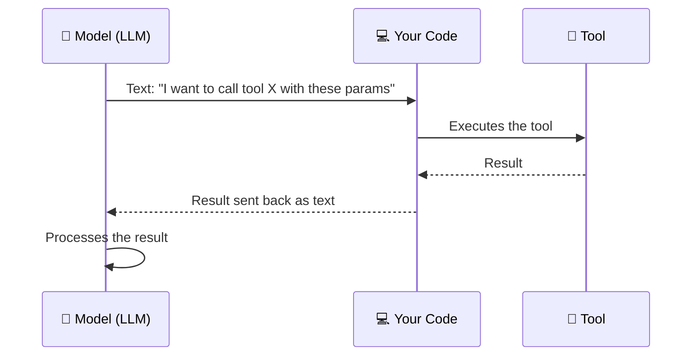
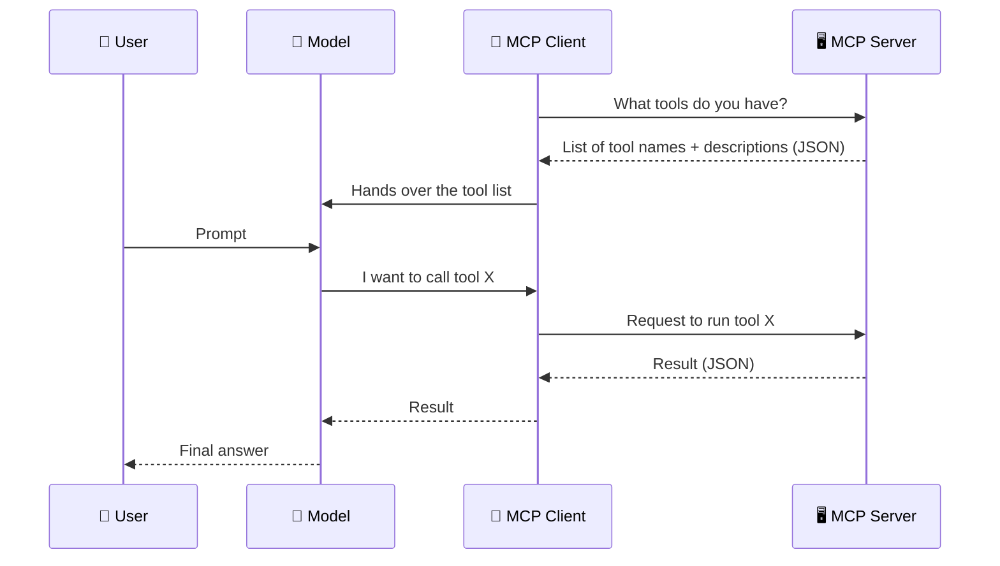
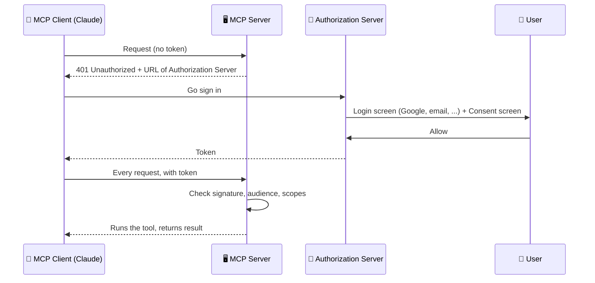

<div align="center">

# 🔌 MCP Explained

### Model Context Protocol, from the basics to OAuth-secured remote servers

*What MCP is · How it works · Local vs Remote · Authentication · Working example in this repo*


</div>

---

## 📑 Table of Contents

1. [What is an MCP Server?](#-what-is-an-mcp-server)
2. [Why MCP was invented](#-why-mcp-was-invented)
3. [Two sides of MCP](#-two-sides-of-mcp)
4. [How it works](#-how-it-works)
5. [Two ways an MCP server can run](#-two-ways-an-mcp-server-can-run)
6. [Problem with remote MCP servers](#-problem-with-remote-mcp-servers)
7. [Security issues with remote MCP servers](#-security-issues-with-remote-mcp-servers)
8. [Why a static key is a problem](#-why-a-static-key-is-a-problem)
9. [OAuth: how it works](#-oauth-how-it-works)
10. [Dynamic Client Registration](#-dynamic-client-registration)
11. [Build it yourself or plug in a tool](#-build-it-yourself-or-plug-in-a-tool)
12. [MCP server in this repo](#-mcp-server-in-this-repo)

---

## 🧠 What is an MCP Server?

> **An MCP server is just a program that gives an AI model a list of functions it can use.**

### Breaking it down in simple terms

- 🗣️ A language model on its own can't do anything. It can't read your files, it can't check your calendar, it can't even query your database. All it can do is take text and give you text as output.
- 🧰 So if you want a model to do something, you have to give it access to **tools**. A tool is really just a function that has a **name**, a **description** and some **parameters** (some input and some output). The model can read this list of tools and decide *"I need to call tool X."*
- ✍️ When your model wants to call a tool, all it really does is **output text** saying which tool it wants to call. **Your code** then executes that tool, and you send the result back to the model (the LLM), where it can process it.
- 🔁 So, **the model never calls the tools, it simply requests to call them.** Your code calls the tool and gives the result back. The model is always working with text.



---

## 🤔 Why MCP was invented

**Before MCP existed**, there was a problem: every single application had to build the tool plumbing we just talked about by itself. And it was different for every single model and every single tool.

> For example, if you built a GitHub integration for Claude, it didn't work inside Cursor, and it didn't work inside ChatGPT.

So everyone was rewriting the same thing over and over again, and we kept getting more and more agents. **MCP was invented as a standard for that.**

MCP stands for **Model Context Protocol**. It means you write your tools **one time** as an MCP server, and then any app that speaks MCP can use those tools. Claude, Cursor, VS Code, ChatGPT, it doesn't matter, any AI agent out there.

> 🔌 People like to refer to MCP as the **USB-C for AI tools**, and that's a pretty good analogy. It's one plug that works in pretty much every adapter.

---

## ⚖️ Two sides of MCP

| Side | What it is | Example |
|------|-----------|---------|
| 🖥️ **MCP Server** | Your code. It exposes the tools. | The server you write |
| 📱 **MCP Client** | The app that the model lives inside of | Claude Desktop, Cursor |

---

## ⚙️ How it works

Your AI agent gets access through the **client**, and the **server** is where you actually write and expose tools.

1. 🚀 When a client starts up, it simply asks the server: **"What tools do you have?"**
2. 📋 The server sends back a list with all the names and descriptions, and that list gets handed to the model.
3. 🎯 When the model wants to call one of these tools, the client sends a request to the server.
4. ▶️ The server runs the tool (the function) and sends back the result.
5. 📦 All of this is handled in **JSON**.



---

## 🌐 Two ways an MCP server can run

### 1️⃣ Local

That just means the client actually launches your server as a **subprocess** running on your machine, and talks to it directly over standard input and output (**stdin / stdout**).

### 2️⃣ Remote (HTTP)

Now your server runs somewhere on the internet. So it has a **URL**, and a client connects to it over **HTTP**. This is how pretty much every real product does it. For example, the GitHub MCP server, the Notion one, Stripe, they're all really just `URLs`.

This is something you want if you're building something for other people, or you want to use your tools from different machines like your phone, your laptop and your work machine.

| | 🏠 Local | ☁️ Remote (HTTP) |
|---|---|---|
| **Runs as** | Subprocess on your machine | Server somewhere on the internet |
| **Talks over** | stdin / stdout | HTTP (via a URL) |
| **Best for** | Personal use, development | Products, multi-device, other people |
| **Access control needed?** | Not really | **Yes, absolutely** |

> ✅ So you have local and remote, and **remote is the preferred option**, especially if you're going to go into production.

---

## ⚠️ Problem with remote MCP servers

Remote is the preferred option, especially if you're going to go into production. However, as soon as you have a remote MCP server, you need to be careful, because you introduce a problem that your local version never would have had.

> 🔐 That problem is **Access Control**.

If your MCP server is on the internet, that means **anyone who has the URL can call your tools**. And your tools do things, right? They read data, they write data, maybe they delete something.

### So you need to answer three questions on every single request:

1. 🙋 **Who is calling this?**
2. 🛂 **What are they allowed to do?**
3. 🎭 **Who are they doing it on behalf of?**

These are the questions that need to be answered if you're going to have a remote MCP server.

---

## 🚨 Security issues with remote MCP servers

- Security audits this year found that about **a quarter of public MCP servers have no authentication at all**. Of the ones that do have something, most are using a **static API key**: just one long-lived secret sitting in a config file that's shared by everyone.
- Only a **tiny fraction** of them actually use the proper authentication scheme, which is **OAuth**.

---

## 🔑 Why a static key is a problem

- If 5 agents are hitting your server and they're all using the same key, **you're not able to tell them apart**.
- You cannot see **which user told which agent to do what**, and if one of them is compromised **you can't revoke just that one**. You have to kill the key and break all of the agents at once.
- That's fine for a short project maybe, but it's **not fine for anything that's real and in production**.

So the official MCP specification actually has an answer for this, and it's the same one that all serious applications have already been using, called **OAuth**. Specifically, they reference **OAuth 2.1 with PKCE**.

---

## 🔓 OAuth: how it works

> 💡 **Your application server does not do login.**

1. When Claude (or any MCP client) tries to call your server without passing a valid token, your server just says **`401 Unauthorized`**. And by the way, here's the URL of the place you can go to actually sign in.
2. That place the server returns is called an **Authorization Server**. The client goes there. The user then sees a normal login screen and can sign in with Google, email, or whatever you've set up. They get a **consent screen**, approve the action, and sign in just like they do with any other application.
3. Basically, the user clicks *Allow* (or whatever the authorization server says). The authorization server then takes a **token** and hands it over to Claude (or whatever agent you're using). That agent then sends that token **with every single request** to your MCP server, and that's what identifies who you are.
4. Your server checks the **signature** of that token and makes sure it was **meant for this specific server**. It checks what **permissions or scopes** are inside, and then it runs the tool.



### 🏷️ Terminology: Scopes

The permissions inside the token are called **scopes**. You might have a `notes:read` scope, a `notes:write` scope, or some other types of scopes, whatever. The tools in your server can say: *"Hey, I need this scope or this permission in order to do that."*

This allows you to not only **authenticate** a user, but also to **control what that user is able to do** and check whether they have the required permissions.

### 👤 The token also tells you who the user is

Embedded inside the token data there will be the **scopes**, the **user ID**, and a little bit more information. That means your server can actually **act on behalf of a user**. So it can scale out and not just work for one individual entity.

---

## 📝 Dynamic Client Registration

There's just one more piece you should be aware of: your client (your AI agent) needs to **register itself with your authorization server** before it's allowed to log in. The spec for this is called **Dynamic Client Registration**, so they can just do it automatically. You don't have to set anything up here, but you should be aware of what's going to happen:

1. 📌 Your client registers with the authorization server: *"Hey, I want to sign in."*
2. 🔗 The authorization server sends a URL to the user.
3. ✅ They sign in.
4. 🎟️ That then grants a token and gives it to the client.
5. 📤 The client then sends that token to the server on every single request, and that identifies **you (the user)** and **all of the scopes** that you have with the MCP server.

---

## 🛠️ Build it yourself or plug in a tool

We can build all of this by ourselves:

- 🖼️ Login page
- 🤝 Consent screen
- ✍️ Token signing
- 📝 Client registration
- 🔄 Refresh logic

...or you can just **plug in something that's already doing this**, which I'm using in this code, because there are a lot of great tools that handle all of the MCP config for you.

---

## 🚀 MCP server in this repo

I've also built one MCP server in this same repo. 👇

<!-- ✏️ Fill in the details below for your server -->

| | |
|---|---|
| 📂 **Files** | `./v1_local.py` (for local mcp), `./v1_remote.py` (for remote mcp) |
| 🧰 **Tools exposed** | `list_my_notes` , `add_a_note` , `delete_a_note` |
| 🌐 **Transport** | Local (stdio) / Remote (HTTP) |
| 🔐 **Auth** | e.g. OAuth 2.1 via _your provider_ |

### ▶️ Run it

```bash
# install dependencies
# start the server
```

### 🔗 Connect it to a client

```json
{
  "mcpServers": {
    "notes-local": {
      "command": "...",
      "args": ["..."]
    }
  }
}
```

---

<div align="center">

⭐ **If this helped you understand MCP, drop a star on the repo!** ⭐

</div># MCP
